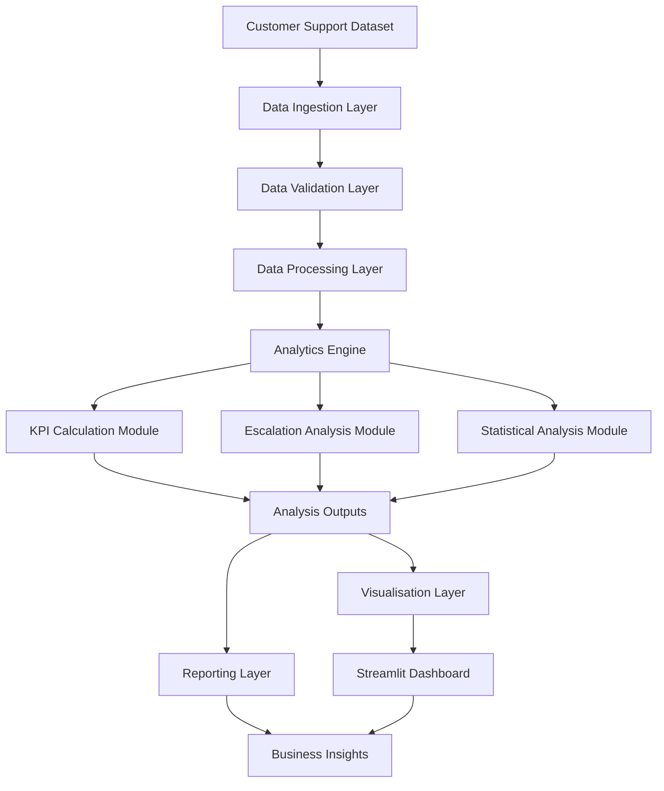
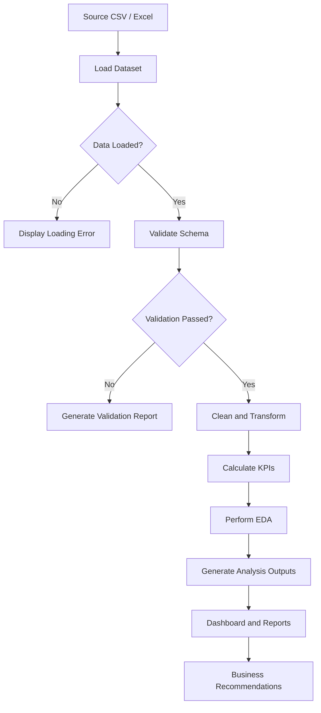
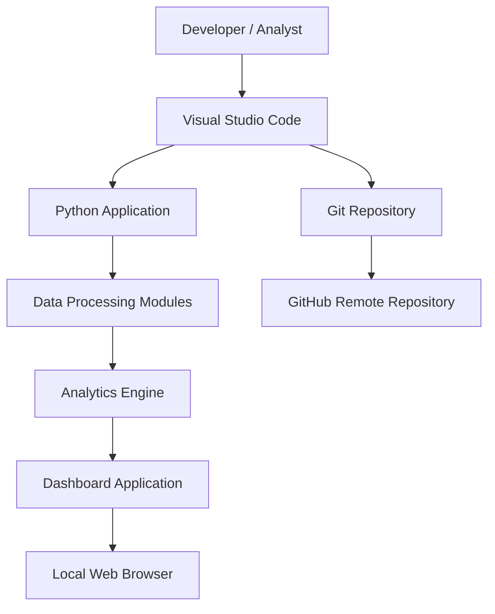

# System Architecture
## Customer Escalation Risk Analysis System

**Version:** 1.0  
**Architecture Style:** Modular Data Processing Pipeline  
**Dashboard Framework:** Streamlit  
**Status:** Proposed Architecture

---

## 1. Architecture Overview

The Customer Escalation Risk Analysis System follows a modular architecture in which individual components perform specific responsibilities.

The architecture separates data ingestion, validation, processing, analytics and presentation to improve maintainability, reusability and testing.

### Architectural Principles

- Separation of concerns.
- Modular development.
- Reusable analytical components.
- Centralised data validation.
- Consistent KPI calculations.
- Independent presentation layer.
- Reproducible analytical workflows.

---

## 2. System Component Architecture

The following diagram illustrates the major system components and their interactions.

---

## 3. Component Responsibilities

### 3.1 Data Ingestion Layer

**Purpose:** Load customer support datasets.

Responsibilities:
- Read CSV and Excel files.
- Identify supported file formats.
- Handle file loading errors.
- Pass raw data to validation.

### 3.2 Data Validation Layer

**Purpose:** Verify the quality and structure of incoming data.

Responsibilities:
- Check required columns.
- Inspect missing values.
- Identify duplicate records.
- Validate data types.
- Detect invalid or inconsistent values.

### 3.3 Data Processing Layer

**Purpose:** Prepare validated data for analysis.

Responsibilities:
- Handle missing values using documented rules.
- Standardise categorical values where appropriate.
- Convert dates and numerical fields.
- Apply approved transformations.
- Preserve raw source data.

### 3.4 Analytics Engine

**Purpose:** Generate analytical outputs.

Subcomponents:

**KPI Calculation Module**
- Ticket volume.
- Escalation rate.
- Response-time metrics.
- Resolution-time metrics.
- SLA performance metrics, where supported.

**Escalation Analysis Module**
- Queue-level analysis.
- Priority-level analysis.
- Channel-level analysis.
- Issue-type analysis.

**Statistical Analysis Module**
- Descriptive statistics.
- Distribution analysis.
- Segment comparisons.
- Relationship analysis.

### 3.5 Visualisation Layer

**Purpose:** Convert analytical results into understandable visual outputs.

Responsibilities:
- Generate charts.
- Display comparisons.
- Show trends and distributions.
- Support interactive filtering.

### 3.6 Dashboard Layer

**Purpose:** Present analytical information through an interactive interface.

Technology: Streamlit.

Proposed sections:
- Executive Overview.
- Ticket Analysis.
- Escalation Analysis.
- Operational Performance.
- Business Insights.

### 3.7 Reporting Layer

**Purpose:** Communicate the analytical findings.

Outputs:
- KPI summaries.
- Visual reports.
- Key findings.
- Business recommendations.

---

## 4. Data Flow Architecture

---

## 5. Proposed Deployment Architecture

The initial system is designed as a local Python application.

The dashboard will initially run locally using Streamlit. Cloud deployment can be considered as a future enhancement.

---

## 6. Technology Mapping

| Layer | Technology |
|---|---|
| Data Source | CSV / Excel |
| Ingestion | Python |
| Validation | Python / Pandas |
| Processing | Pandas / NumPy |
| Analytics | Pandas / NumPy |
| Visualisation | Matplotlib / Seaborn / Plotly |
| Dashboard | Streamlit |
| Testing | Pytest |
| Version Control | Git / GitHub |

---

## 7. Error Handling Strategy

The architecture will handle common failures at the relevant component.

| Component | Possible Error | Handling |
|---|---|---|
| Ingestion | Missing file | Report file-not-found error |
| Ingestion | Unsupported format | Reject unsupported file |
| Validation | Missing required column | Report schema error |
| Validation | Invalid data type | Report validation issue |
| Processing | Transformation failure | Record error and stop affected operation |
| Analytics | Empty dataset | Return a controlled result or informative error |
| Dashboard | Missing analysis output | Display an informative message |

---

## 8. Security and Data Protection

- Do not expose customer personal information in public reports.
- Keep confidential raw datasets out of public GitHub repositories.
- Use `.gitignore` to prevent accidental data uploads.
- Avoid storing credentials in source code.
- Restrict access to sensitive datasets.

---

## 9. Architecture Constraints

- The initial implementation uses batch file processing.
- The architecture is designed for exploratory and diagnostic analytics.
- Actual dataset fields and KPI definitions must be confirmed before implementation.
- Dashboard calculations must use validated analytical outputs.
- Predictive modelling is outside the initial core architecture unless permitted as an extension.

---

## 10. Future Architecture Improvements

Potential enhancements include:
- Automated data ingestion.
- Scheduled reporting.
- Cloud dashboard deployment.
- Integration with support-ticket platforms.
- Additional analytical modules.

---

**Document Status:** Proposed system architecture. Implementation details will be refined after dataset inspection.