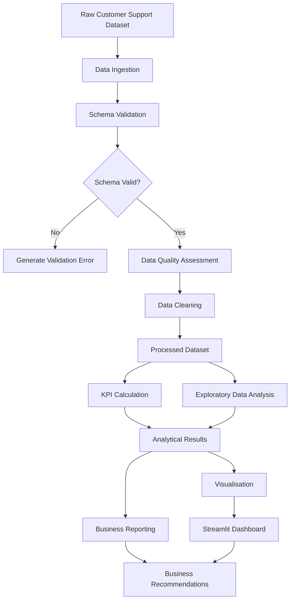
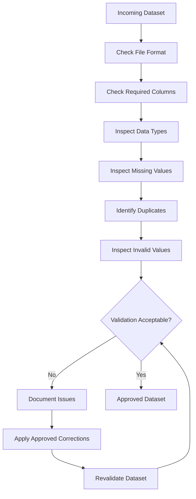

# Data Flow Design
## Customer Escalation Risk Analysis System

**Version:** 1.0  
**Document Type:** Data Flow Design  
**Status:** Proposed Design

---

## 1. Introduction

### 1.1 Purpose

This document describes how data moves through the Customer Escalation Risk Analysis System.

It defines the sequence of data ingestion, validation, cleaning, transformation, analytics, visualisation and reporting.

### 1.2 Objective

The objective is to establish a consistent and traceable data-processing workflow that transforms raw customer support ticket data into meaningful analytical outputs.

---

## 2. Overall Data Flow

The system follows this processing sequence:

1. Dataset collection.
2. Data ingestion.
3. Schema validation.
4. Data quality assessment.
5. Data cleaning and transformation.
6. KPI calculation.
7. Exploratory data analysis.
8. Visualisation.
9. Dashboard presentation.
10. Business reporting.

### Data Flow Diagram

---

## 3. Data Flow Stages

### 3.1 Stage 1 — Data Collection

**Input:** Customer support ticket dataset.

**Supported formats:** CSV and Excel.

**Output:** Source dataset.

The original dataset is retained without modification.

### 3.2 Stage 2 — Data Ingestion

**Component:** Data Ingestion Layer.

Operations:
- Read the input file.
- Identify the file extension.
- Load data into a Pandas DataFrame.
- Handle file-reading errors.

**Output:** Raw DataFrame.

### 3.3 Stage 3 — Schema Validation

**Component:** Data Validation Layer.

Operations:
- Check expected column names.
- Verify required fields.
- Inspect data types.
- Identify missing fields.

**Output:** Schema validation result.

Invalid datasets should generate clear error messages rather than continuing silently.

### 3.4 Stage 4 — Data Quality Assessment

Operations:
- Calculate missing-value counts.
- Identify duplicate records.
- Inspect inconsistent categories.
- Identify invalid numerical values.
- Inspect timestamp consistency where applicable.

**Output:** Data quality report.

### 3.5 Stage 5 — Data Cleaning and Transformation

**Component:** Data Processing Layer.

Operations:
- Apply documented missing-value handling rules.
- Handle duplicates according to approved criteria.
- Standardise categorical values where appropriate.
- Convert supported data types.
- Derive analytical fields only when justified.

**Output:** Processed dataset.

All cleaning decisions must be documented.

### 3.6 Stage 6 — KPI Calculation

**Component:** Analytics Engine.

Potential metrics include:
- Total ticket volume.
- Escalated ticket count.
- Escalation rate.
- First-response time.
- Resolution time.
- SLA performance.

Only metrics supported by the actual dataset and official definitions will be implemented.

**Output:** KPI results.

### 3.7 Stage 7 — Exploratory Data Analysis

Operations:
- Compare escalation patterns across queues.
- Examine priority-level differences.
- Analyse ticket channels.
- Compare issue categories.
- Examine response and resolution distributions.
- Investigate time-related patterns where data permits.

**Output:** Analytical summaries and findings.

### 3.8 Stage 8 — Visualisation

The visualisation layer transforms analytical results into charts.

Potential charts:
- Escalation distribution.
- Escalation rate by queue.
- Escalation by priority.
- Response-time distribution.
- Resolution-time comparison.
- SLA performance comparison.

**Output:** Visual reports and dashboard charts.

### 3.9 Stage 9 — Dashboard Presentation

The Streamlit application presents:
- KPI summaries.
- Interactive filters.
- Escalation analysis.
- Operational performance.
- Visual comparisons.
- Business insights.

### 3.10 Stage 10 — Business Reporting

The final analytical outputs are used to prepare:
- Key findings.
- High-risk operational segments.
- Evidence-based interpretations.
- Exactly three prioritised management recommendations.

---

## 4. Data Storage Flow

The project uses a structured local directory for data organisation.

| Directory | Purpose |
|---|---|
| `data/raw/` | Original source files |
| `data/processed/` | Cleaned analytical datasets |
| `reports/charts/` | Generated charts |
| `notebooks/` | Exploratory analysis notebooks |

Raw data must remain unchanged.

Sensitive customer data must not be committed to a public GitHub repository.

---

## 5. Data Quality and Validation Flow

The validation process should preserve an audit trail of detected issues and applied corrections.

---

## 6. Analytical Data Flow

The analytical engine receives validated processed data.

It produces:

1. KPI summaries.
2. Segment-level comparisons.
3. Distribution statistics.
4. Escalation-related patterns.
5. Visualisation-ready results.

The same metric definitions should be reused in reports and dashboard components.

---

## 7. Error Handling and Recovery

| Stage | Error | Expected Behaviour |
|---|---|---|
| Ingestion | Missing file | Stop loading and report error |
| Ingestion | Unsupported format | Reject file |
| Validation | Missing required field | Report schema issue |
| Cleaning | Invalid transformation | Record error and stop affected operation |
| Analytics | Missing metric field | Mark metric unavailable |
| Visualisation | Empty results | Display informative message |
| Dashboard | Missing analysis output | Show controlled warning |

The system should not fabricate missing values or analytical results.

---

## 8. Data Traceability

Each analytical output should be traceable to:

- Its source dataset.
- The validation and cleaning operations applied.
- The relevant analytical function.
- The metric definition.
- The visualisation or report using that result.

This improves reproducibility and supports technical review.

---

## 9. Data Flow Constraints

- The initial system uses batch-based file ingestion.
- Dataset schema is subject to confirmation.
- Cleaning operations must be documented.
- KPI denominators must follow official definitions.
- Unresolved and incomplete tickets require explicit treatment.
- The dashboard must use consistent analytical results.

---

## 10. Expected Outcome

The data flow design provides a structured and reproducible process for converting customer support ticket data into validated analytics, interactive visualisations and actionable business recommendations.

---

**Document Status:** Proposed data flow design. Dataset-specific processing rules will be finalised after source data inspection.