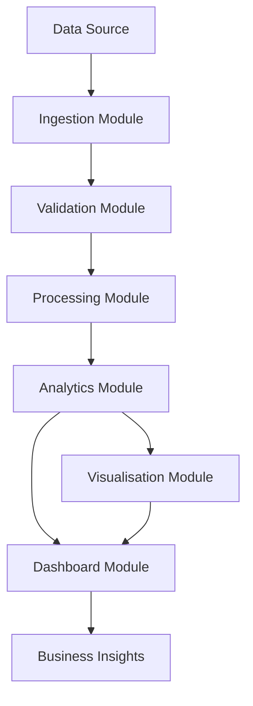
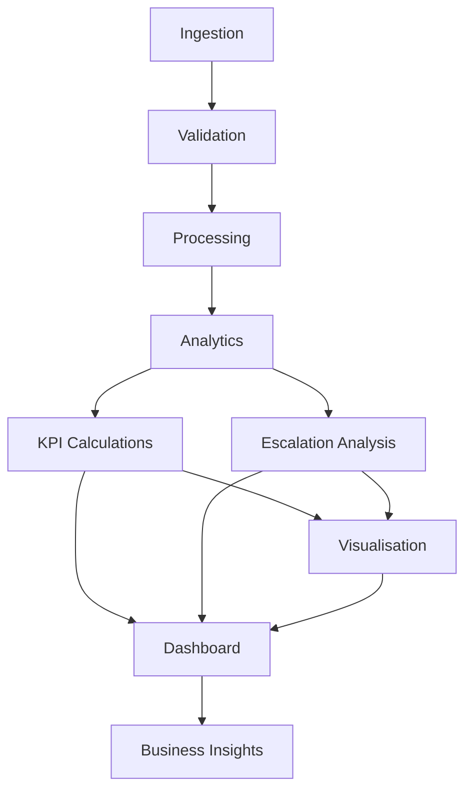

# Module Design
## Customer Escalation Risk Analysis System

**Version:** 1.0  
**Document Type:** Module Design Specification  
**Architecture:** Modular Python Architecture  
**Status:** Proposed Design

---

## 1. Introduction

### 1.1 Purpose

This document defines the internal modules of the Customer Escalation Risk Analysis System.

It describes each module's responsibilities, interfaces, dependencies and interactions.

### 1.2 Design Objectives

- Establish clear module boundaries.
- Maintain separation of concerns.
- Support independent module development.
- Encourage reusable Python functions.
- Simplify testing and debugging.
- Support integration with the Streamlit dashboard.

---

## 2. Module Architecture

The application is divided into six primary modules.

1. Data Ingestion
2. Data Validation
3. Data Processing
4. Analytics
5. Visualisation
6. Dashboard

### Module Interaction Diagram

---

## 3. Data Ingestion Module

**Directory:** `src/ingestion/`

**Primary File:** `data_loader.py`

### Responsibilities

- Load CSV files.
- Load Excel files.
- Validate file extensions.
- Handle file-loading errors.
- Return datasets in DataFrame format.

### Proposed Interface

`load_dataset(file_path)`

**Input:** Source file path.

**Output:** Pandas DataFrame.

**Dependencies:** Pandas, Python standard library.

---

## 4. Data Validation Module

**Directory:** `src/validation/`

**Primary File:** `data_validator.py`

### Responsibilities

- Validate required columns.
- Inspect data types.
- Identify missing values.
- Identify duplicate records.
- Detect invalid values.
- Generate data quality summaries.

### Proposed Interfaces

- `validate_schema()`
- `check_missing_values()`
- `check_duplicates()`
- `validate_data_types()`
- `generate_quality_report()`

**Input:** Raw DataFrame and validation configuration.

**Output:** Validation results and quality report.

---

## 5. Data Processing Module

**Directory:** `src/processing/`

**Primary File:** `data_cleaner.py`

### Responsibilities

- Standardise column names where appropriate.
- Handle missing values using approved rules.
- Apply duplicate-handling policies.
- Convert data types.
- Prepare data for analysis.
- Preserve source data.

### Proposed Interfaces

- `clean_column_names()`
- `handle_missing_values()`
- `remove_duplicates()`
- `convert_data_types()`
- `prepare_dataset()`

**Input:** Validated DataFrame.

**Output:** Processed DataFrame and cleaning summary.

---

## 6. Analytics Module

**Directory:** `src/analytics/`

This module contains the core analytical business logic.

### 6.1 KPI Calculation Module

**File:** `kpi_calculations.py`

Responsibilities:
- Calculate ticket volume.
- Calculate escalated ticket counts.
- Calculate escalation rate.
- Calculate response-time metrics.
- Calculate resolution-time metrics.
- Calculate SLA metrics where supported.

### 6.2 Escalation Analysis Module

**File:** `escalation_analysis.py`

Responsibilities:
- Analyse escalation patterns by queue.
- Compare priority categories.
- Analyse communication channels.
- Compare issue categories.
- Examine operational performance differences.

**Input:** Processed DataFrame and metric configuration.

**Output:** Structured analytical summaries.

---

## 7. Visualisation Module

**Directory:** `src/visualization/`

**Primary File:** `visualizations.py`

### Responsibilities

- Generate escalation charts.
- Visualise ticket distributions.
- Compare queue performance.
- Display priority-level patterns.
- Visualise response and resolution distributions.
- Prepare charts for reports and dashboard use.

### Proposed Interfaces

- `plot_escalation_distribution()`
- `plot_queue_comparison()`
- `plot_priority_analysis()`
- `plot_response_distribution()`
- `plot_resolution_distribution()`

**Dependencies:** Matplotlib, Seaborn and Plotly.

---

## 8. Dashboard Module

**Directory:** `dashboard/`

**Primary File:** `app.py`

### Responsibilities

- Provide an interactive user interface.
- Display KPI cards.
- Provide analytical filters.
- Display charts and comparisons.
- Present important business findings.
- Communicate recommendations.

**Technology:** Streamlit.

The dashboard will consume validated analytical outputs rather than maintaining separate KPI calculation logic.

---

## 9. Module Dependency Structure

The dashboard depends on the analytics and visualisation components. Core analytical functions should remain independent of Streamlit.

---

## 10. Configuration and Shared Utilities

Common configuration and reusable functionality may be introduced as the implementation grows.

Potential responsibilities:

- Centralised application configuration.
- Logging.
- File path management.
- Shared validation rules.
- Common error messages.

These utilities should avoid duplicating module-specific business logic.

---

## 11. Testing Responsibilities

Each module should be tested independently.

| Module | Testing Focus |
|---|---|
| Ingestion | File loading and format validation |
| Validation | Schema and data quality checks |
| Processing | Cleaning and transformation |
| Analytics | KPI accuracy and segment analysis |
| Visualisation | Chart generation |
| Dashboard | Filters, outputs and error states |

Pytest will be used for automated tests.

---

## 12. Design Constraints

- Actual dataset columns remain subject to confirmation.
- Function signatures may be refined during implementation.
- KPI calculations must follow official definitions.
- Missing data must be handled transparently.
- Analytical logic must be independent of the dashboard.
- No predictive modelling is included in the core design unless permitted as an extension.

---

## 13. Expected Outcome

The module design provides a clear development blueprint for implementing the Customer Escalation Risk Analysis System.

It supports modular development, maintainability, testability and future enhancements.

---

**Document Status:** Proposed module design. Final interfaces will be confirmed during dataset integration and implementation.